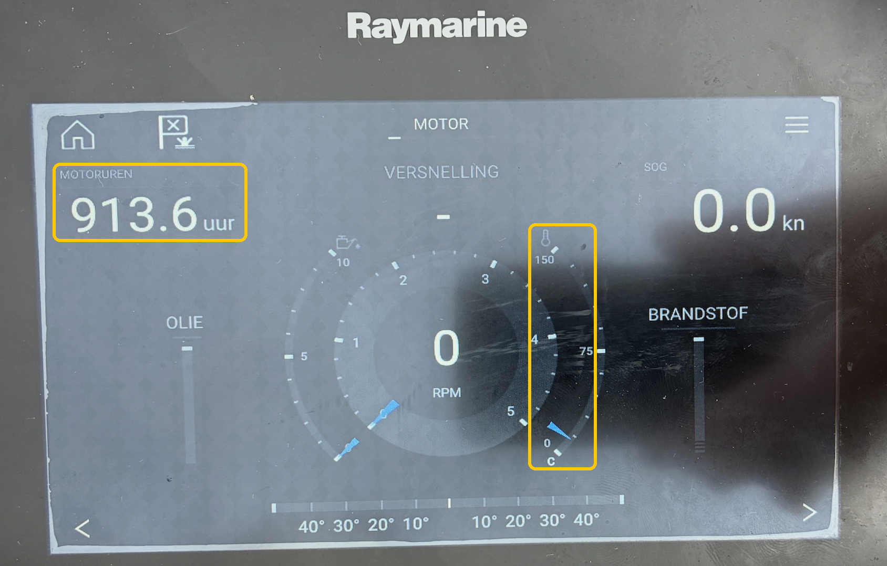
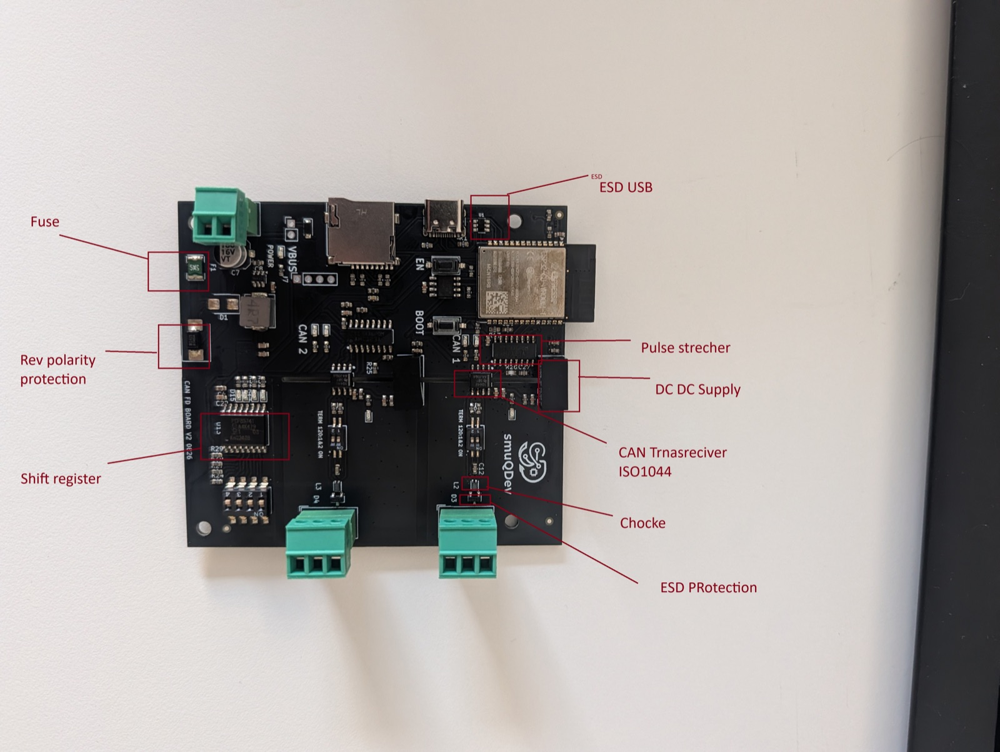

# J1939 → NMEA 2000 Gateway — Volvo Penta D1 series

A non-invasive gateway that reads SAE J1939 engine telemetry from a **Volvo Penta D1-series** engine and broadcasts it as standard **NMEA 2000 PGNs** onto an N2K backbone. It was tested specifically on a **D1-30B**.

The VDO tachometer stays connected to the Volvo MDI control box through the existing Deutsch DT 6-pin harness. The gateway is tapped onto that harness with three wires (CAN_H, CAN_L and GND). It listens passively on the J1939 bus — transmitting nothing onto the engine bus — and converts engine speed, coolant temperature, engine hours, battery voltage, and alarm states into PGN 127488, 127489 and 127497, making them visible on any NMEA 2000 compatible chartplotter or MFD.

```
Volvo Penta MDI ──── Deutsch DT 6-pin ──── VDO Tachometer
                            │
                            │  3 wires: CAN_H, CAN_L, GND
                            │
                       [ Gateway ] ──── NMEA 2000 backbone
```

The engine page of the Raymarine eS75 MFD, fed by the gateway (engine stopped, ignition on). The engine hours (913.6) and the coolant temperature gauge are highlighted:



## Quick start

```bash
cp firmware-esp32c5/src/wifi_secrets.example.h firmware-esp32c5/src/wifi_secrets.h   # then set name and password
pio run -d firmware-esp32c5 -t upload --upload-port /dev/cu.usbmodemXXXX             # first flash over USB
nc 192.168.4.1 23                                                                    # log, after joining the gateway's Wi-Fi
```

Then open `http://192.168.4.1/` for the settings page. Details are in [Set up and flash](#set-up-and-flash).

## Repository layout

| Path | Contents |
| :--- | :--- |
| `firmware-esp32c5/src/` | Firmware sources, see [Firmware overview](#firmware-overview) |
| `firmware-esp32c5/host_test/` | Unit tests that run on the computer (`run.sh`) |
| `design/esp32c5/` | [Specification](design/esp32c5/volvo-d130-esp32c5-dual-can-spec-plan.md), [implementation plan and field test log](design/esp32c5/implementation-plan.md), board CAN schematic |
| `design/` | [Hardware comparison](design/hardware-comparison.md), [Deutsch DT harness build guide](design/deutsch-dt-y-splitter.md), [fuel table source](design/fuel-consumption-source.md), [J1939 captures](design/captures/README.md) |
| `images/` | Pictures used in the documentation |
| `AGENTS.md` | Working notes for AI assistants |

## Hardware platform

The selected platform is the **[SmuqDev ESP32-C5 Dual Isolated CAN FD](https://www.tindie.com/products/smuqdev/esp32-c5-dual-can-fd-wi-fi-6-gateway-logger/)** (~$59). The other options that were considered are in [`design/hardware-comparison.md`](design/hardware-comparison.md).

- Two fully galvanically isolated CAN ports (TI ISO1044BDR, separate DC-DC per channel)
- Both ports native hardware TWAI — no SPI CAN controller needed
- 120Ω termination per channel via DIP switch (both OFF for this installation)
- Wi-Fi 6 + Bluetooth 5, MicroSD + RTC (on the board, not used by the firmware)
- ESP32-C5 RISC-V @ 240 MHz, 16 MB Flash, 8 MB PSRAM
- Power jumper next to the USB port: **out** when the N2K backbone powers the board, **in** when powering from USB-C only (with the jumper out, USB-C does not power the board)



Board CAN pins (set in [`config.h`](firmware-esp32c5/src/config.h)). The numbering follows the terminals on the board and the web page:

| Bus | Role | Mode | Speed | TX | RX |
| :--- | :--- | :--- | :--- | :--- | :--- |
| terminal CAN 1 | Volvo MDI J1939 (engine) | listen-only, never transmits | 250 kbps | GPIO 23 | GPIO 24 |
| terminal CAN 2 | NMEA 2000 backbone | active (transmits) | 250 kbps | GPIO 4 | GPIO 5 |

## Firmware overview

Sources are in [`firmware-esp32c5/src/`](firmware-esp32c5/src/):

| File | Purpose |
| :--- | :--- |
| `main.cpp` | Starts NVS, fuel service, both CAN buses, Wi-Fi access point, log server, HTTP server |
| `j1939_receiver.h` | J1939 receiver on CAN 1: the interrupt queues frames, a task decodes PGN 61444, 65262, 65253, 65271 and 65226. Every 5 s it logs a bus overview (frames, PGNs, source addresses). With `J1939_RAW_LOG 1` in `config.h` (default 0) it also logs every payload change of the PGNs that are not decoded |
| `j1939_dm1.h` | DM1 alarm decoder (oil pressure SPN 100, temperature SPN 110, SPN 168) |
| `engine_state.h` | Mutex-protected engine values with a 3 s engine-stop watchdog |
| `bus_status.h` | "Is there traffic on this bus?" check for the page header |
| `n2k_gateway.h` | NMEA 2000 node on CAN 2: address claim, sends PGN 127488 (10 Hz), 127489 and 127497 (1 Hz). Also listens for GPS position and time from any GNSS device on the N2K bus. With `N2K_DUMMY_DATA 1` in `config.h` (default 0) it sends a simulated engine (800–2200 RPM over 60 s, 75 °C, 13.8 V, 1234.5 h) while no J1939 traffic arrives, for bench tests |
| `gps_state.h` | Latest GPS position and UTC time received from the N2K bus (PGN 129029, 129025, 126992) |
| `NMEA2000_esp32c5.h/.cpp` | CAN driver class for the `NMEA2000` library on the C5 |
| `fuel_model.h`, `fuel_service.h` | Fuel estimate from RPM, trip maths, storage in flash |
| `fuel_web.h`, `web_ui.h` | JSON API and the settings page |
| `wifi_manager.h`, `remote_logger.h`, `ota_manager.h` | Wi-Fi access point, TCP log on port 23, firmware update over Wi-Fi |

The standard `NMEA2000_esp32` driver cannot be used on the C5 (it includes Xtensa-only headers), so the project has its own driver class on top of the ESP-IDF TWAI API.

## Set up and flash

### Access point name and password

The gateway makes its own Wi-Fi network (access point); it does not join any other network. The name and password are kept out of version control. The firmware reads them from `firmware-esp32c5/src/wifi_secrets.h`, which is listed in [`.gitignore`](.gitignore) and will never be committed. Create it from the template (see Quick start) and edit it:

```cpp
#define AP_SSID         "J1939-N2K-Gateway"
#define AP_PASSWORD     "your-password"      // 8-63 characters
```

If the file is missing, the build stops with an error that tells you to create it.

> Before pushing to GitHub, run `git status --untracked-files=all` and check that `wifi_secrets.h` is not listed.

### Build and flash

```bash
pio run -d firmware-esp32c5 -t upload --upload-port /dev/cu.usbmodemXXXX
```

If the board does not enter download mode by itself, hold **BOOT**, press **EN**, then release **BOOT**. The serial port must be free: close any `pio device monitor` before flashing.

**Later updates need no cable.** Build, then push the image over Wi-Fi (the computer must be connected to the gateway's own network):

```bash
pio run -d firmware-esp32c5
curl -X POST -H "X-Gateway: 1" --data-binary @firmware-esp32c5/.pio/build/esp32c5-gateway/firmware.bin http://192.168.4.1/update
```

The board restarts after about 15 seconds. You can also use the upload form at the bottom of the settings page. If the board is in a bootloop, only the USB cable will bring it back.

### Watch the log

Join the Wi-Fi network named `AP_SSID`. The gateway always has the address **192.168.4.1**. Your computer gets an address from the gateway and has no internet while connected (the gateway does not route). Connect to the TCP monitor on port 23 (`telnet` also works, but macOS no longer ships with it):

```bash
nc 192.168.4.1 23
```

The log shows, among other things:

- `[J1939] frames=… PGN … SA … n=… last:` every 5 s: how many J1939 frames arrived, from which source addresses, and which PGNs. This is the quickest way to see whether the engine bus is alive.
- Every 10 s the N2K source address and the number of PGNs sent / not accepted.

## Settings page

Open `http://192.168.4.1/` in a browser on your phone or laptop (connected to the gateway's own network). One page holds everything (`/fuel` and `/update` show the same page):

- **Header**: "Engine Data J1939 (CAN1)" and "NMEA 2000 (CAN2)" show *Connected* when frames arrived in the last 3 seconds, otherwise *no data*.
- **Live**: two lamps (oil pressure, temperature: grey = no data, green = OK, red = alarm), engine speed, coolant temperature, engine hours, battery voltage, estimated fuel rate, trip average, trip fuel, trip engine time and how long the engine has been off. Also GPS position and GPS time (UTC) when a GNSS device on the N2K bus sends them.

  

- **Fuel table** (RPM → litres/hour): add, edit and delete rows, save, or restore the default.

  

- **Trip**: press "Reset now" to zero the trip immediately. Also set after how many minutes with the engine off the next start counts as a new trip (default 60, 0 = never automatic).
- **Firmware update**: choose a `.bin` file and upload it over Wi-Fi. The page waits for the gateway to restart and reloads itself.

  

The page has no login; only devices that know the access point password can reach it. Writes need a custom `X-Gateway` header, so a random web page cannot change values through your browser.

## Fuel estimate

The D1-30 does not report fuel use on J1939, so the gateway estimates it from engine speed. Table and trip changes are stored in flash and survive a power cycle. The default table comes from a D1-30 owner's figures on [myHanse](https://www.myhanse.com/average-fuel-consumption_topic11698.html), see [`design/fuel-consumption-source.md`](design/fuel-consumption-source.md); calibrate it against real refuelling on your own installation. Expect 10–20 % error from load changes.

A new trip starts automatically when the engine is started after being off for the set time; the previous trip stays visible until then. The off time is only counted while the gateway has power. The full behaviour is in the [specification](design/esp32c5/volvo-d130-esp32c5-dual-can-spec-plan.md#46-fuel-estimate-and-trip).

## Unit tests

Run on the computer, no board needed:

```bash
firmware-esp32c5/host_test/run.sh
```

Each test prints `N checks, 0 failed`. They cover the fuel maths and automatic new trip, the DM1 alarm decoder and the bus-activity check.

## Status and known limits

**Verified on a real D1-30B with the engine stopped and ignition on:** J1939 reception (17,474 frames in 20 s, 0 receive errors), engine hours matching the tachometer (913.6 h), coolant temperature and battery voltage, and the end-to-end path to a Raymarine eS75 MFD. The VDO tachometer and the MDI keep working normally.

**Not yet verified:** everything with the engine running (engine speed, coolant temperature rising, CAN error counters under load), and oil pressure: no PGN 65263 and no DM1 message has been seen, so the two lamps on the page only mean "nothing reported".

**Known limits:**

- Undecoded PGNs on the engine bus (65417, 65420, 65352, 65373, 65283, 65256, 65376, 65276): see [`design/captures/README.md`](design/captures/README.md).
- The NMEA 2000 sender claims source address 22 and sends engine instance 0.
- Without J1939 traffic the gateway sends no engine values (all fields "not available"), unless `N2K_DUMMY_DATA` is 1.
- The oil and temperature lamps decode a single-frame DM1 message only; several simultaneous faults (transport protocol) are not read.
- The TCP log (port 23) and the web page have no login.

The test results are in the [field test log](design/esp32c5/implementation-plan.md#2-field-test-log); the open items and next steps are in the [implementation plan](design/esp32c5/implementation-plan.md).

## Troubleshooting NMEA 2000

If the gateway does not show up on the MFD, go through this list. The bench findings behind it are in the [field test log](design/esp32c5/implementation-plan.md#bench-can-bring-up-findings).

1. **Power the N2K backbone.** A NMEA 2000 backbone needs 12 V on its red/black pair from the network's own supply. The board does not supply it. Power the board from the same 12 V source as the network.
2. **Connect the ground.** Connect the 12 V ground (black) to the **`GND_ISO`** pin of the CAN terminal. The yellow LED (VCC_ISO) of the channel lights when the isolated side is powered.
3. **Wiring:** white = CAN_H, blue = CAN_L (NMEA 2000 colours). N2K goes on terminal **CAN 2** (GPIO 4/5), the engine J1939 on terminal **CAN 1** (GPIO 23/24).
4. **Termination:** the bus needs 120 Ω at each end (two terminators). The board's own 120 Ω DIP switches stay OFF when the board is in the middle of the bus.
5. **Bitrate 250 kbit/s, classic CAN, normal (not listen-only) mode** for the N2K node. It must ACK, and it transmits its address claim and PGNs. A wrong bitrate gives only errors.
6. **Verify:** `nc 192.168.4.1 23` shows `busActive=YES`, `devices=1` or more and `sent` growing; the gateway appears in the MFD's device list as "J1939-N2K Gateway" (source address 22).

## License

Apache License 2.0, see [`LICENSE`](LICENSE).
